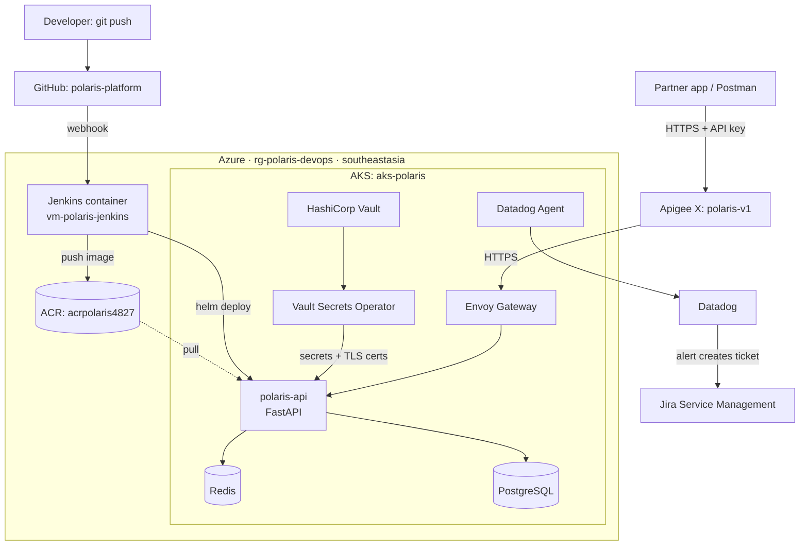

# Polaris Platform

A production-style **Policy & Claims API platform** on Azure Kubernetes Service (AKS), built to practise
day-2 operations end to end: CI/CD, secrets & certificate management, caching, API management,
observability and incident response.

## Architecture



## Stack

| Area | Tool |
|---|---|
| Cloud | Azure (AKS, ACR, VM), region `southeastasia` |
| IaC | Terraform (azurerm 4.x, remote state in Azure Storage), TFLint |
| CI/CD | Jenkins (Docker on VM, JCasC, Job DSL), Helm, Trivy |
| Secrets & PKI | HashiCorp Vault + Vault Secrets Operator |
| Data | Redis (TLS + ACL), PostgreSQL |
| Edge | Apigee X, Envoy Gateway (Gateway API) |
| Observability | Datadog (metrics, logs, APM, SLOs) |
| ITSM | Jira Service Management (incidents, changes) |

## Environment

| Resource | Name | Details |
|---|---|---|
| Resource group | `rg-polaris-devops` | All platform resources |
| Container registry | `acrpolaris4827` | Basic, admin user disabled |
| AKS cluster | `aks-polaris` | 1 × Standard_B2as_v2 (2 vCPU / 8 GB), Kubernetes 1.36, Azure CNI Overlay + Cilium |
| Jenkins VM | `vm-polaris-jenkins` | Standard_B2als_v2 (2 vCPU / 4 GB), Ubuntu 24.04, managed identity; Jenkins 2.580.2 (JDK 25) controller + agent in Docker |
| Network | `vnet-polaris` (10.10.0.0/16), `nsg-polaris-jenkins` | SSH from the admin IP only |
| Namespaces | `dev`, `prod`, `platform-ops` | Pod Security labels |
| Terraform state | `stpolaristf4827` in `rg-polaris-tfstate` | Entra ID auth only, versioning + soft delete |

## Roadmap

- [x] Phase 0 — Accounts, tools, region & quota checks
- [x] Phase 1 — Azure infrastructure in Terraform (RG, ACR, AKS, Jenkins VM)
- [x] Phase 2 — Jenkins controller + agent in Docker, configured as code
- [ ] Phase 3 — Vault + Vault Secrets Operator
- [ ] Phase 4 — Redis (TLS, ACL) + PostgreSQL
- [ ] Phase 5 — polaris-api (FastAPI) + Helm chart
- [ ] Phase 6 — CI/CD pipeline (dev → approval → prod)
- [ ] Phase 7 — Envoy Gateway + Apigee proxy
- [ ] Phase 8 — Datadog observability
- [ ] Phase 9 — Jira incident & change automation
- [ ] Phase 10 — Operations drills + RCAs

## Repository layout

| Folder | Contents |
|---|---|
| `infra/` | Terraform (`terraform/`), state bootstrap, shared names (`env.sh`), Jenkins VM public key |
| `app/` | polaris-api source, tests, Dockerfile |
| `helm/` | Helm chart for polaris-api |
| `k8s/` | Namespaces, Redis, PostgreSQL, gateway, Vault Secrets Operator manifests |
| `vault/` | Vault policies and setup scripts |
| `jenkins/` | Host setup, controller and agent images, JCasC, pipelines, Docker Compose stack |
| `apigee/` | API proxy bundle |
| `datadog/` | Monitors and dashboards as code |
| `runbooks/` | Operational runbooks (symptom → cause → fix) |
| `drills/` | Evidence from operations drills |
| `rca/` | Root-cause analysis reports |
| `docs/` | Notes, diagrams, decision records and evidence |

## Infrastructure as code

All Azure resources are managed with Terraform in `infra/terraform/`. State is stored remotely
in Azure Storage with Entra ID auth (no account keys), versioning and soft delete.
Kubernetes objects live in `k8s/` and `helm/`.

```bash
source infra/env.sh             # names, subscription ID, your IP for the SSH rule
cd infra/terraform
terraform init
terraform plan -out=tfplan      # review the plan
terraform apply tfplan          # apply exactly what was reviewed
```

## Jenkins

Jenkins runs on `vm-polaris-jenkins` as two containers, defined entirely in `jenkins/`:

- **Controller:** pinned Jenkins 2.580.2 on JDK 25 with baked-in plugins, configured by JCasC;
  0 executors; jobs created by Job DSL
- **Agent:** inbound WebSocket agent with az, kubectl, helm and the Docker CLI
- **Access:** UI bound to `127.0.0.1:8080`, reached through an SSH tunnel; never exposed

The `platform-smoke-test` job proves the path end to end: managed identity login, image push
to ACR, and AKS access, with no credentials stored in Jenkins
([evidence](docs/evidence/phase-2-smoke-test.txt)).

**Security baseline**

- No stored cloud credentials: AKS pulls from ACR (`AcrPull`), Jenkins pushes (`AcrPush`) and
  deploys (`AKS Cluster User`) with managed identities; token caches are wiped after each build
- Jenkins VM: SSH key only; the NSG allows port 22 from the admin IP only; the Jenkins UI is
  reached through an SSH tunnel, never exposed
- ACR admin user disabled; `dev` and `prod` enforce Pod Security `baseline`

## Decisions

- [0001: Deploy to Southeast Asia on B-series v2 VMs](docs/decisions/0001-region-southeastasia.md)
- [0002: Manage Azure infrastructure with Terraform and remote state](docs/decisions/0002-terraform-remote-state.md)
- [0003: Run Jenkins in Docker on a VM, configured as code](docs/decisions/0003-jenkins-in-docker-on-vm.md)

## Runbooks

- [Jenkins VM SSH access](runbooks/jenkins-vm-ssh-access.md)
- [Jenkins operations](runbooks/jenkins-operations.md)

## Cost control

Stop everything when not working:

```bash
az aks stop --resource-group rg-polaris-devops --name aks-polaris
az vm deallocate --resource-group rg-polaris-devops --name vm-polaris-jenkins
```

Start again:

```bash
az aks start --resource-group rg-polaris-devops --name aks-polaris
az vm start --resource-group rg-polaris-devops --name vm-polaris-jenkins
```

The Jenkins VM also shuts down automatically at 23:00 IST. Start AKS before running `terraform apply`.
Jenkins containers start automatically with the VM.

---

## Author

**Subash Chandra Bose**: DevOps, Cloud & Security Engineer · Microsoft Certified (SC-500, AZ-104, SC-200)
[Portfolio](https://subash-1507.github.io) · [LinkedIn](https://www.linkedin.com/in/subash-chandra-bose-014bb21b5) · [GitHub](https://github.com/Subash-1507)
