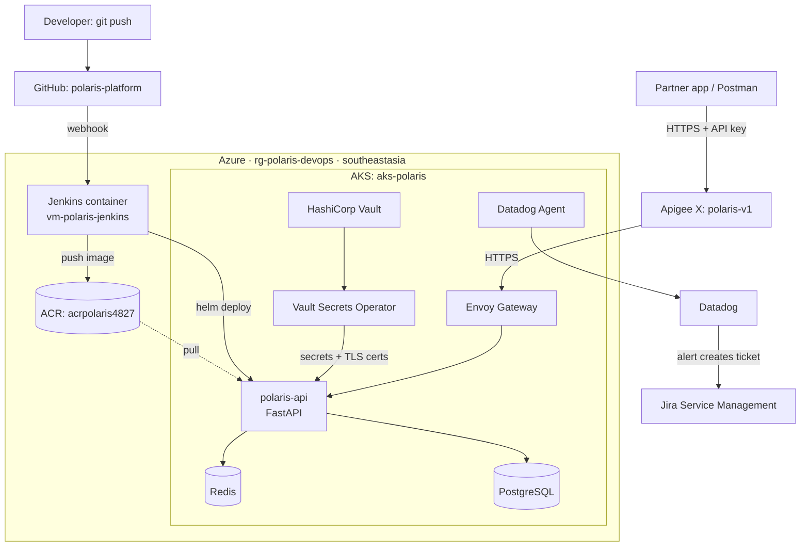

# Polaris Platform

A production-style **Policy & Claims API platform** on Azure Kubernetes Service (AKS), built to practise
day-2 operations end to end: CI/CD, secrets & certificate management, caching, API management,
observability and incident response.

## Architecture



## Stack

| Area | Tool |
|---|---|
| Cloud | Azure (AKS, ACR, VM), region `southeastasia` |
| CI/CD | Jenkins (Docker on VM), Helm, Trivy |
| Secrets & PKI | HashiCorp Vault + Vault Secrets Operator |
| Data | Redis (TLS + ACL), PostgreSQL |
| Edge | Apigee X, Envoy Gateway (Gateway API) |
| Observability | Datadog (metrics, logs, APM, SLOs) |
| ITSM | Jira Service Management (incidents, changes) |

## Environment

| Resource | Name | Size |
|---|---|---|
| Resource group | `rg-polaris-devops` | — |
| Container registry | `acrpolaris4827` | Basic |
| AKS cluster | `aks-polaris` | 1 × Standard_B2as_v2 (2 vCPU / 8 GB) |
| Jenkins VM | `vm-polaris-jenkins` | Standard_B2als_v2 (2 vCPU / 4 GB) |
| Namespaces | `dev`, `prod`, `platform-ops` | — |

## Roadmap

- [x] Phase 0 — Accounts, tools, region & quota checks
- [ ] Phase 1 — Azure infrastructure (RG, ACR, AKS, Jenkins VM)
- [ ] Phase 2 — Jenkins controller in Docker
- [ ] Phase 3 — Vault + Vault Secrets Operator
- [ ] Phase 4 — Redis (TLS, ACL) + PostgreSQL
- [ ] Phase 5 — polaris-api (FastAPI) + Helm chart
- [ ] Phase 6 — CI/CD pipeline (dev → approval → prod)
- [ ] Phase 7 — Envoy Gateway + Apigee proxy
- [ ] Phase 8 — Datadog observability
- [ ] Phase 9 — Jira incident & change automation
- [ ] Phase 10 — Operations drills + RCAs

## Repository layout

| Folder | Contents |
|---|---|
| `infra/` | Azure setup scripts and shared names (`env.sh`) |
| `app/` | polaris-api source, tests, Dockerfile |
| `helm/` | Helm chart for polaris-api |
| `k8s/` | Redis, PostgreSQL, gateway, Vault Secrets Operator manifests |
| `vault/` | Vault policies and setup scripts |
| `jenkins/` | Jenkins controller image and ops jobs |
| `apigee/` | API proxy bundle |
| `datadog/` | Monitors and dashboards as code |
| `runbooks/` | One runbook per alert |
| `drills/` | Evidence from operations drills |
| `rca/` | Root-cause analysis reports |
| `docs/` | Notes, diagrams and decision records |

## Decisions

- [0001: Deploy to Southeast Asia on B-series v2 VMs](docs/decisions/0001-region-southeastasia.md)

## Cost control

Stop everything when not working:

```bash
az aks stop --resource-group rg-polaris-devops --name aks-polaris
az vm deallocate --resource-group rg-polaris-devops --name vm-polaris-jenkins
```

Start again:

```bash
az aks start --resource-group rg-polaris-devops --name aks-polaris
az vm start --resource-group rg-polaris-devops --name vm-polaris-jenkins
```

---

## Author

**Subash Chandra Bose**: DevOps, Cloud & Security Engineer · Microsoft Certified (SC-500, AZ-104, SC-200)
[Portfolio](https://subash-1507.github.io) · [LinkedIn](https://www.linkedin.com/in/subash-chandra-bose-014bb21b5) · [GitHub](https://github.com/Subash-1507)